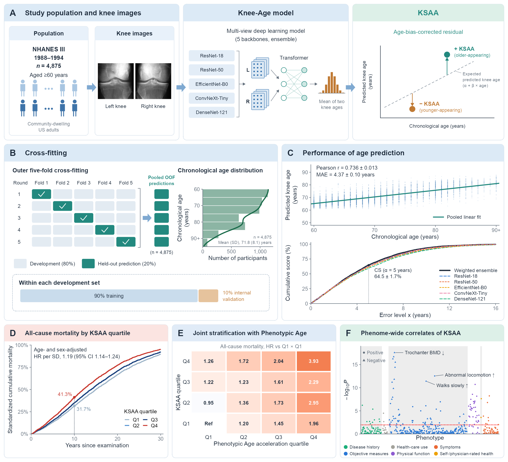

# Deep learning–estimated skeletal age acceleration from knee radiographs and long-term mortality in older US adults

[](https://www.r-project.org/)
[](https://www.python.org/)
[](https://pytorch.org/)
[](https://wwwn.cdc.gov/nchs/nhanes/nhanes3/)

## Table of Contents
1. [Introduction](#1-introduction)
2. [Setup Environment](#2-setup-environment)
3. [Quick Start](#3-quick-start)
   - [3.1 Per-participant KSAA](#31-per-participant-ksaa)
   - [3.2 Check the Phenome-Wide Scan](#32-check-the-phenome-wide-scan)
4. [Reproduce the Analyses](#4-reproduce-the-analyses)
   - [4.1 Run the Pipeline](#41-run-the-pipeline)
   - [4.2 Where Each Result Comes From](#42-where-each-result-comes-from)
5. [Knee Age Model](#5-knee-age-model)
   - [5.1 Image Processing](#51-image-processing)
   - [5.2 Training](#52-training)
   - [5.3 Applying the Models to New Radiographs](#53-applying-the-models-to-new-radiographs)
6. [Interpretability](#6-interpretability)
7. [Data and Licenses](#7-data-and-licenses)

## 1. Introduction

**Knee skeletal age acceleration (KSAA)** measures how much older or younger a person's knees look on plain radiographs than their chronological age. An ensemble of five deep learning backbones (ResNet-18, ResNet-50, EfficientNet-B0, ConvNeXt-Tiny, DenseNet-121), adapted from Mammo-AGE to read both knees together, estimates age from the bilateral knee radiographs of **4,875 NHANES III participants aged ≥60 years** (1988–1994). Each participant's prediction comes from models that did not see them (participant-level five-fold cross-fitting), and KSAA is the residual of predicted knee age regressed on chronological age, with the regression estimated in the training folds.

In survey-weighted analyses with mortality follow-up through 2019, KSAA is associated with all-cause and cause-specific mortality, adds prognostic information beyond Phenotypic Age acceleration, the Kellgren–Lawrence (K–L) grade and bone mineral density, and is related to 482 phenotypes in a phenome-wide association study (PheWAS).



This repository contains the code and public-use derived data needed to reproduce every table, figure and in-text number of the manuscript. The radiographs are not redistributed; they are public at <https://ftp.cdc.gov/pub/NHANES/XRays/Nhanes3/> (4,908 knee films, about 171 GB).

```
run_all.sh             reproduces every table, figure and in-text number from data/ (about 15 min)
code/analysis/         KSAA construction and all statistical analyses (R; Figure 4A in Python)
code/images/           radiograph download, YOLO11 knee detection, ROI cropping (GPU)
code/model/            knee age model (adapted Mammo-AGE), five-fold cross-fitting, full-data training (GPU)
code/interpretability/ occlusion sensitivity maps (Fig. S2) and related checks (GPU)
data/                  public-use NHANES III inputs and the backbones' out-of-fold predictions
data/derived/          analysis-ready data and per-participant KSAA, exactly as used for the manuscript
models/                description and checksums of the full-data models (weights distributed separately)
environment/           R and Python package versions
```

## 2. Setup Environment

```r
# R >= 4.3 (the analyses used R 4.5.2); exact versions in environment/R_packages.txt
install.packages(c("DBI", "duckdb", "ggplot2", "ggrepel", "here", "MASS", "mice",
                   "openxlsx", "patchwork", "png", "ragg", "survey", "survival"))
```

```bash
# Figure 4 only: CLARITE needs its own Python (<= 3.10)
conda create -n clarite python=3.9 -y
conda activate clarite
pip install clarite==2.3.6 PyMuPDF Pillow
```

Model training and interpretability (sections 5–6) additionally need PyTorch and a GPU; see `environment/python_requirements.txt`.

## 3. Quick Start

No pipeline run is needed to look at the results: `data/derived/` holds the analysis-ready data exactly as used for the manuscript (see [`data/derived/README.md`](data/derived/README.md)).

### 3.1 Per-participant KSAA

```r
p <- read.csv("data/derived/ensemble_predictions.csv")   # one row per participant (n = 4,875)
# SEQN, fold, age, pred_raw, pred_corr (bias-corrected predicted knee age), gap_raw, ksaa, q (quartile)

d    <- read.csv("data/derived/analysis_dataset.csv")    # KSAA, outcomes, survey design variables, covariates
dict <- read.csv("data/derived/data_dictionary.csv")     # meaning, unit and NHANES III source of every column
```

KSAA can also be rebuilt from the backbones' out-of-fold predictions in `data/predictions/` with the fold-specific ensemble weights and bias-correction coefficients in `data/derived/`.

### 3.2 Check the Phenome-Wide Scan

```bash
# refits PheWAS phenotypes from data/derived/ alone and compares n, estimates and P values with the shipped results
Rscript code/analysis/check_phewas_refit.R
```

## 4. Reproduce the Analyses

### 4.1 Run the Pipeline

```bash
bash run_all.sh                                             # all steps; outputs go to results/
CLARITE_PY=~/miniconda3/envs/clarite/bin/python bash run_all.sh   # CLARITE in a separate environment (Figure 4)
bash run_all.sh manuscript_tables                           # re-run one step (earlier steps must have run)
```

The pipeline starts from the NHANES III files in `data/nhanes3/` and the out-of-fold predictions in `data/predictions/`. Its last step, `verify_derived`, compares the regenerated results with `data/derived/` and stops with an error if any value differs. Tables are written to `results/analysis/tables/` (HTML) and `results/analysis/weighted/` (CSV), figures to `results/figures/`, and console logs to `results/logs/`.

Primary analyses are survey-weighted: `weighted_common.R` builds the design on all 17,705 adult examinees (NHANES III examination weights, strata and primary sampling units; phase 2 weights for analyses of the K–L reading) and analyzes the cohort as a domain. Bootstrap CIs use Rao–Wu rescaling bootstrap replicate weights (`weighted_boot.R`; 500 replicates for standardized risks, 200 for discrimination). Follow-up runs from the examination (`PERMTH_EXM`) to death or 31 December 2019; Phenotypic Age acceleration is winsorized at the 1st and 99th percentiles.

### 4.2 Where Each Result Comes From

Outputs used in the manuscript are named after the manuscript item; scripts are in `code/analysis/`.

| Manuscript item | Output (under `results/`) | Script |
|---|---|---|
| KSAA | `ksaa_oof.csv` | `ksaa_ensemble.R` |
| Table 1 | `analysis/tables/table1.html` | `manuscript_tables.R` |
| Table 2 | `analysis/weighted/table2.csv` | `weighted.R` |
| Figure 1 | `figures/Figure1/Figure1.{pdf,png}` | `weighted.R`, `weighted_boot.R`, `phewas.R` → `fig1.R` |
| Figure 2 | `figures/Figure2.{pdf,png}` | `weighted_boot.R` → `fig2_mortality.R` |
| Figure 3 | `figures/Figure3.{pdf,png}` | `weighted.R`, `weighted_boot.R` → `fig3_incremental.R` |
| Figure 4 | `figures/Figure4.{pdf,png}` | `phewas.R` → `fig4_phewas.R`, `fig4_phewas_clarite.py` |
| Table S1 | `analysis/tables/tableS1.html` | `tableS1_performance.R`, `manuscript_tables.R` |
| Table S2 | covariate definitions (text) | `build_analysis_data.R` |
| Table S3 | `analysis/tables/tableS3.html` | `quartile_characteristics.R` → `manuscript_tables.R` |
| Tables S4, S5, S7, S10 | `analysis/weighted/tableS{4,5,7,10}.csv` | `weighted.R` |
| Table S6 | `analysis/weighted/tableS6.csv` | `weighted_boot.R` |
| Tables S8, S9 | `analysis/tables/tableS{8,9}.html`; all results in `analysis/phewas/phewas_results.csv` | `phewas_clean.R`, `phewas_audit.R`, `phewas.R` → `phewas_table.R` |
| Fig. S1 | `figures/FigureS1.{pdf,png}` | `figS1_biascorr.R` |
| Fig. S2 | `figures/FigureS2.{pdf,png}` (run separately, section 6) | `code/interpretability/` |
| Fig. S3 | `figures/FigureS3.{pdf,png}` | `weighted.R` → `fig2_mortality.R` |
| Partial correlations with K–L grade and BMD | `analysis/kl_dxa_partial_cor.csv` | `kl_bmd_partial_cor.R` |
| Other in-text numbers | `logs/manuscript_numbers.txt` and the CSV files above | `manuscript_numbers.R` |

The Figure 2 P values for trend use all 4,875 participants (age and sex adjusted); the Table 2 P values use the 4,347 participants with complete Model 3 covariates.

## 5. Knee Age Model

These steps produced the inputs shipped in `data/` and are not needed to reproduce the analyses. Paths are set at the top of each script.

### 5.1 Image Processing

Download the CDC TIFFs, detect both knees with a fine-tuned YOLO11s detector, crop square 16-bit ROIs (1.15 × the bounding-box width), recover failed detections, and scan ROIs for bright artifacts ([`code/images/README.md`](code/images/README.md)).

```bash
bash code/images/knee_xray_download.sh    # 4,908 knee radiographs from the CDC FTP site
bash code/images/pipeline.sh              # conversion, detection, ROI cropping
```

### 5.2 Training

`code/model/knee_v2.py` trains the adapted Mammo-AGE model: a shared ImageNet-pretrained backbone for both knees, a four-block transformer, and probabilistic ordinal embedding heads over 100 one-year age classes (POE and mean–variance losses).

```bash
bash code/model/train_5fold.sh    # section 1: five backbones x five folds (split seed 20260831) -> data/predictions/
bash code/model/train_full.sh     # each backbone once on all participants, for new radiographs
```

Later sections of `train_5fold.sh` are ablations not reported in the manuscript ([`code/model/README.md`](code/model/README.md)).

### 5.3 Applying the Models to New Radiographs

The five full-data checkpoints (`m5_full_<backbone>_full.pt`, 559 MB in total) are distributed separately; place them in `models/`. Combine them with the ensemble weights and bias correction in `data/derived/new_data_calibration.csv`:

```
pred_raw = Σ ensemble_weight × predicted age of each checkpoint
KSAA     = pred_raw − (33.555 + 0.5271 × age)
```

Loading, preprocessing and checksums are described in [`models/README.md`](models/README.md). Predictions for weight-bearing views, digital radiography or adults younger than 60 years have not been validated.

## 6. Interpretability

Occlusion sensitivity maps (Fig. S2) show how much the predicted age changes when a 64 × 64-pixel patch of the radiograph is blurred. They use the full-data checkpoints and the ROI images and run separately from `run_all.sh`.

```bash
python code/interpretability/occlusion_map.py --seqn 1587,41357,32486,10939,45540,12181 --side R --tag _examples
python code/interpretability/occlusion_figure.py     # -> results/figures/FigureS2.{png,pdf}
python code/interpretability/corner_occlusion.py     # corner occlusion test in the 487 internal-validation participants
```

Grad-CAM maps and region occlusion tests are also included ([`code/interpretability/README.md`](code/interpretability/README.md)).

## 7. Data and Licenses

All inputs derive from public-use files of the National Center for Health Statistics (NCHS): the NHANES III (1988–1994) household adult, examination and laboratory files, the NHANES III knee radiographs, and the NCHS 2019 public-use Linked Mortality File. Users must follow the NCHS data-use restrictions, including that no attempt be made to identify any participant. [`data/README.md`](data/README.md) describes every shipped file.

- Code written for this study: [license to be added].
- `code/model/mammo_age_model.py`, `transformer.py`, `probordiloss.py`, `mean_variance_loss.py` and `metrics.py` are from the official Mammo-AGE implementation (Apache License 2.0, `code/model/LICENSE_Mammo-AGE`). In `mammo_age_model.py` and `transformer.py` the number of views (`N_VIEWS`; 2 knees instead of 4 mammographic views), the global dropout rate (`DROP`) and the import path were changed; the other three files are unchanged.
- Knee detection uses Ultralytics YOLO11 (AGPL-3.0) as an installed dependency; no Ultralytics code or detector weights are included.
- NHANES data are in the public domain.

Many code comments are in Chinese.
